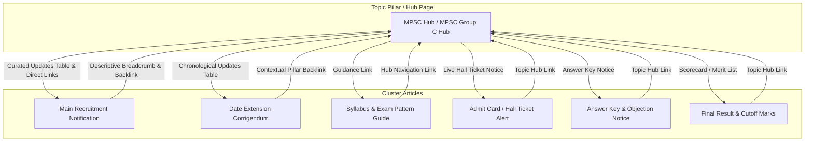

# MahaSandhi Article Publishing, Category Routing & Content Architecture Rules

> **Status**: Official Master Rulebook (Single Source of Truth)  
> **Target Website**: [MahaSandhi.in](https://mahasandhi.in) — Government Jobs, Hall Tickets, Exam Results, Admissions & Career Guidance  
> **Core Principle**: **Helpful, Verified Content & Strict Category Separation.** Never allow Results, Admit Cards, or Admissions to leak into general recruitment or homepage feeds. Build structured Pillar-and-Cluster topical authority with two-way internal links, verified dates, and direct official source links.

---

## 📌 Section 1: Page Distribution Matrix & Article Routing Rules

Every article published on MahaSandhi must have a strictly defined **Content Type (`postType`)** and an appropriate **Category**. Articles are routed deterministically according to this matrix:

| Article / Post Type | Homepage (`/`) | Current Recruitment (`/current-recruitment`) | Mega Recruitment (`/mega-recruitment`) | Dedicated Category Page | Relevant Pillar Page |
| :--- | :---: | :---: | :---: | :--- | :--- |
| **Normal Recruitment / Job Vacancy** | ✅ Yes | ✅ Yes | ❌ No (unless > 1,000 vacancies) | Relevant category page (e.g., `/bank-recruitment`) | Relevant recruitment pillar (if exists) |
| **Mega Recruitment** | ✅ Yes | ✅ Yes | ✅ Yes (Vacancies > 1,000 only) | `/mega-recruitment` | Relevant mega/exam pillar |
| **Result** | 🚫 **STRICT NO** | 🚫 **STRICT NO** | 🚫 **STRICT NO** | `/result` only | Relevant exam result pillar (e.g., MPSC Result, SSC Result) |
| **Admit Card / Hall Ticket** | 🚫 **STRICT NO** | 🚫 **STRICT NO** | 🚫 **STRICT NO** | `/admit-card` only | Relevant exam hall ticket pillar (e.g., MPSC Hall Ticket) |
| **Admission** | 🚫 **STRICT NO** | 🚫 **STRICT NO** | 🚫 **STRICT NO** (by default) | `/admission` only | Relevant course/institution admission pillar |
| **Exam Information / Syllabus** | Sectional / Relevant Hub | ❌ No | ❌ No | `/syllabus` or `/mpsc` sub-guides | Relevant exam pillar |
| **General Educational Article / Free Coaching** | Specific widget only | ❌ No | ❌ No | `/naukri-updates` / relevant category | Relevant scheme pillar (e.g., Mahajyoti/BARTI/SARTHI) |
| **Answer Key** | ❌ No (unless critical notice) | ❌ No | ❌ No | `/answer-key` | Relevant exam pillar |

> [!IMPORTANT]
> **Priority Over Generic Rules**: These strict routing rules override broad rules such as "show every new article on the homepage". Under no circumstances may a Result, Admit Card, or Admission article be displayed on the Homepage, `/current-recruitment`, or `/mega-recruitment` feeds.

---

## 📌 Section 2: Result and Admit Card — Strict Page Restrictions

1. **Absolute Exclusion from Recruitment Feeds**:
   - Result and Admit Card articles **MUST NEVER** appear on:
     - The Homepage (`src/pages/index.astro`) main jobs list (`latestJobs`).
     - Current Recruitment page (`src/pages/current-recruitment.astro`).
     - Mega Recruitment page (`src/pages/mega-recruitment.astro`).
     - General latest-post sections or recruitment widgets.
2. **Authorized Placement Only**:
   - **Result Posts**: Appear **ONLY** on the dedicated Result listing (`/result`) and its relevant exam-specific result pillar page (e.g., MPSC Result, Police Bharti Result).
   - **Admit Card Posts**: Appear **ONLY** on the dedicated Admit Card listing (`/admit-card`) and its relevant exam-specific hall ticket pillar page (e.g., MPSC Hall Ticket, Police Bharti Admit Card).
3. **Component Guardrails**:
   - Shared feeds, listing widgets, and reusable UI components must filter out Result and Admit Card posts unless the component is explicitly dedicated to Results or Admit Cards.
4. **Permitted Pillar Context**:
   - A Result or Admit Card post **MAY** appear in an update list on a specific Pillar Page *only when that pillar directly represents that specific examination or recruitment drive* (e.g., an MPSC Group C Result link inside `/mpsc-combine-group-c-2026`).

---

## 📌 Section 3: Admission Articles Policy

1. **Designated Location**:
   - All admission notifications (e.g., MHT CET Counselling, ITI Admission, Polytechnic, MBA/MCA CET, D.El.Ed, University admissions) belong **exclusively to the Admission section** (`/admission`) and their specific topic pillar pages.
2. **Exclusion from Job Feeds**:
   - Admission posts **MUST NOT** automatically enter the Homepage, Current Recruitment (`/current-recruitment`), or Mega Recruitment (`/mega-recruitment`).
   - Do **NOT** misclassify an admission notification as a recruitment post simply because it contains an application window or fee deadline.
3. **Admission Pillar Creation**:
   - When an admission topic involves multiple recurring stages (e.g., Registration, Merit List, Option Form, CAP Round 1/2/3), create a dedicated Admission Pillar page (e.g., `/admission/iti-admission-2026-maharashtra`).
4. **Mandatory Links**:
   - Every admission post must feature direct, verified official links to the admission authority (e.g., State CET Cell `cetcell.mahacet.org`, DVET `dvet.gov.in`).

---

## 📌 Section 4: Recruitment & Mega Recruitment Rules

1. **Normal Recruitment Posts**:
   - Announcing active government job vacancies, bank jobs, police bharti, central or state recruitments.
   - Automatically display on the **Homepage** (`/`) and **Current Recruitment** (`/current-recruitment`).
   - Sorted in reverse chronological order (newest at top).
   - Display countdown badges (`Apply Now`, `Notice`, `Closed`) based on verified closing dates.
2. **Mega Recruitment Page Display Rule (> 1,000 Vacancies)**:
   - **Criteria**: If a recruitment notification announces **greater than 1,000 total vacancies** (`vacancies > 1000`), it **MUST** be displayed on `/mega-recruitment`.
   - **Exclusion**: If a recruitment campaign has **1,000 or fewer vacancies** (`vacancies <= 1000`), it **MUST NOT** be displayed on `/mega-recruitment`.
   - **Strict Distinction**: Do **NOT** place Result or Admit Card posts on `/mega-recruitment`, even if the underlying exam originally had > 1,000 vacancies. Mega Recruitment is strictly for active job openings.

---

## 📌 Section 5: Pillar & Cluster Architecture (Topic Hubs)

To build deep topical authority and structured user journeys, MahaSandhi operates a **Hub-and-Spoke (Pillar & Cluster)** content model.



### Pillar Creation & Lifecycle Rules:

1. **Search Before Creation**: Before creating a new pillar page, verify if a suitable pillar page already exists (e.g., check `/mpsc`, `/mpsc-combine-group-c-2026`, `/sbi-recruitment`, `/district/*`).
2. **Reuse Existing Pillars**: If a pillar already exists for that exam, board, or organization, add the new article to the existing pillar rather than creating duplicate or fractured pages.
3. **Justification Threshold**: Create a new pillar page *only* when the topic has sufficient ongoing or recurring updates to justify a dedicated landing hub (e.g., major recurring recruitment drives like RRB NTPC, SSC CGL, MPSC State Services, Police Bharti, ITI Admission).
4. **No Thin Pillar Pages**: Never create a hollow, one-article pillar page just to satisfy a keyword. A pillar page must offer comprehensive introductory context, key dates, syllabus/pattern breakdown, and a clean tabular index of all cluster updates.
5. **Two-Way Internal Linking Standards**:
   - **Pillar → Cluster**: The pillar page must feature a chronological listing (e.g., `<MpscUpdatesBox />` or `updatesArticles` table) linking directly to individual cluster articles.
   - **Cluster → Pillar**: Every cluster article MUST link back to its parent pillar page using natural, descriptive anchor text (e.g., `👉 सर्व MPSC गट-क अपडेट्स, अभ्यासक्रम व निकाल पाहण्यासाठी येथे क्लिक करा`).
6. **No Duplicate URLs**: Never create multiple URLs for the same topic (e.g., do not create both `/mpsc-result-2026` and `/mpsc-results-2026`). Maintain canonical clarity.

---

## 📌 Section 6: Preservation of Prior Posts & Historical Pillar Content

When publishing a new update for an existing pillar:

1. **Never Overwrite Existing Pages**:
   - Do **NOT** overwrite the pillar page with a new article.
   - Do **NOT** delete, replace, or overwrite older valid articles (e.g., when publishing the Result, do not overwrite the original Recruitment Notification or the Hall Ticket article).
2. **Stable URLs & History**:
   - Keep existing URLs and slugs intact. Existing indexed URLs must remain permanent to preserve search equity and historical records.
3. **Newest Updates at the Top**:
   - Add the new update to the top of the relevant listing table on the pillar page.
   - Older updates must remain visible immediately below in strict reverse chronological order.
4. **Publication Date Integrity**:
   - Every article must preserve its original publication date (`date` / `publishedAt`).
   - **NEVER** alter an old article's publication date to make it appear fresh.
   - If an article is genuinely revised (e.g., last date extended), update the `updatedAt` or `extendedDate` field while preserving the original `publishedAt`.
5. **Visual Distinction**:
   - Differentiate newly published articles (e.g., `< 48 hours` pulse badge / `NEW UPDATE`) from older archived entries.

---

## 📌 Section 7: Mandatory Official Source Links

Every Result and Admit Card post carries critical user trust. To ensure E-E-A-T and prevent misleading information:

1. **Mandatory Official Source Section**:
   - Every Result or Admit Card post MUST include a dedicated official source block containing:
     - Direct Official Result Page / Scorecard URL or official PDF link.
     - Direct Official Admit Card Download / Candidate Login URL.
     - Official Examination Authority Portal Homepage.
     - Official Corrigendum / Government Gazette link where applicable.
2. **Centralized Link Management (`src/constants/links.ts`)**:
   - All official external URLs (MPSC, CET Cell, Mahajyoti, BARTI, SARTHI, India Post, SSC, SBI, BHC, etc.) **MUST** be registered in `src/constants/links.ts` (`OFFICIAL_LINKS`).
   - Always check `src/constants/links.ts` before adding a new link.
   - If present, reference `OFFICIAL_LINKS.keyName`.
   - If new, add the verified official link to `OFFICIAL_LINKS` first, then reference it.
3. **Strict Verification Rules**:
   - **No Fabricated URLs**: Never invent URLs or guess deep links.
   - **No Third-Party Impersonation**: Never label unofficial blogs, coaching centers, or aggregator portals as "Official".
   - **Direct vs. Homepage Distinction**: Clearly label whether a button leads to the *Direct Scorecard / Login Portal* or the *Issuing Authority Homepage*.
   - **Unconfirmed Link Handling**: If the exact result PDF or hall ticket link is not yet active, link to the verified official authority notice board and explicitly state: *"अधिकृत लिंक लवकरच सक्रिय होईल / Link will be activated on official portal"*. Never provide fake download buttons.
4. **Descriptive Action Labels**:
   - Use accessible, descriptive button text:
     - ✅ `Check Result on Official Portal (mpsc.gov.in)`
     - ✅ `Download Hall Ticket Direct Link`
     - ✅ `Download Official Corrigendum PDF`
     - ❌ `Click Here` or `Download Now` (without context)

---

## 📌 Section 8: Date and Deadline Accuracy Rules

1. **Verified Dates Only**:
   - Display dates **ONLY** when confirmed by an official government gazette, public notification, or authentic authority press release.
   - **Never invent, estimate, or assume dates** based on speculative social media posts or competing blogs.
2. **Omit When Unavailable**:
   - If an exam date, admit card release date, or result declaration date is not officially specified, **omit the date field completely**.
   - Do NOT use misleading placeholder phrases like *"Coming in 2 days"* or fabricate specific dates.
3. **Distinct Date Fields**:
   - Maintain clear separation between:
     - `publishedAt` / `date`: Article publication date.
     - `updatedAt`: Content revision timestamp.
     - `lastDate`: Normal application closing date.
     - `extendedDate`: Officially extended last date.
     - `examDate`: Scheduled examination date.
     - `resultDate`: Official result declaration date.
     - `admitCardReleaseDate`: Hall ticket download start date.
4. **No Misleading Freshness**:
   - Do not write *"Released Today"* unless the official document was genuinely issued today.

---

## 📌 Section 9: Article Listings and Sorting Standards

1. **Reverse Chronological Order**:
   - All eligible listings (`/`, `/current-recruitment`, `/mega-recruitment`, `/result`, `/admit-card`, `/admission`, `/district/*`) must display the newest valid post first.
2. **Deterministic Sorting Rule**:
   - Primary Sort: Actual publication date (`date` / `publishedAt`) descending.
   - Secondary Sort: If dates are identical, sort by priority (`priority: "mega"` > `"important"` > `"normal"`), or by ID/slug deterministically.
3. **No Artificial Date Bumping**:
   - Never change an article's original date solely to push it back to the top of a general feed.
4. **De-duplication**:
   - When filtering posts across multiple categories or tags, ensure each article appears at most once in a single list.

---

## 📌 Section 10: Metadata Schema & Central Registry Standards

Every article in MahaSandhi is registered in `src/constants/articles.ts` (`articlesRegistry`) adhering to the `ArticleMeta` data contract:

### Standard Metadata Schema:

```typescript
export type PostType = "recruitment" | "result" | "admit-card" | "admission" | "notice" | "answer-key";
export type PostPriority = "normal" | "important" | "mega";
export type EducationTag = "10th" | "12th" | "iti" | "diploma" | "degree" | "pg" | "engg" | "medical" | "law" | "sports" | "other";

export interface ArticleMeta {
  titleEn: string;                  // Required: Descriptive English title with year
  titleMr: string;                  // Required: Accurate Marathi title with year
  slug: string;                      // Required: Root URL slug (e.g., "/mpsc-group-c-bharti-2026")
  category: string;                  // Required: Primary display category
  date: string;                      // Required: Human-readable publication date (e.g., "October 08, 2026")
  image: string;                     // Required: Valid WebP/CDN image URL
  postType: PostType;                // Required: Strict classification for routing
  priority?: PostPriority;           // Optional: "normal" | "important" | "mega"
  isImportant?: boolean;             // Optional: Flags breaking urgency
  postName?: string;                 // Optional: Post / Designation name
  descriptionMr?: string;            // Optional: Concise Marathi overview
  vacancies?: string;                // Optional: Total vacancies count (e.g., "5,236")
  lastDate?: string;                 // Optional: Application deadline or notice date
  extendedDate?: string;             // Optional: Extended deadline if corrigendum issued
  examDate?: string;                 // Optional: Confirmed examination date
  resultDate?: string;               // Optional: Confirmed result declaration date
  admitCardReleaseDate?: string;     // Optional: Confirmed hall ticket release date
  admissionDeadline?: string;        // Optional: Admission/counselling deadline
  pillarPage?: string;               // Optional: Associated Pillar hub slug (e.g., "/mpsc-combine-group-c-2026")
  educationTags?: EducationTag[];    // Optional: Educational eligibility tags
  districts?: string[];              // Optional: District slugs (or ["all-maharashtra"])
  status?: "apply-now" | "closed" | "upcoming" | "declared" | "available";
  organisation?: string;             // Optional: Issuing authority / organization
  officialWebsiteUrl?: string;       // Optional: Key or direct URL to official portal
  officialResultUrl?: string;        // Optional: Direct result check URL
  officialAdmitCardUrl?: string;     // Optional: Direct hall ticket URL
  officialNotificationUrl?: string;  // Optional: Official notification PDF URL
}
```

> [!NOTE]
> If an article cannot be classified with 100% confidence, flag it for editorial review before publishing rather than defaulting to an incorrect page.

---

## 📌 Section 11: Route Architecture & URL Standards

1. **Root URL Standard for Major Articles**:
   - Main recruitment, result, admit card, and standalone articles must be created at root level: `src/pages/[article-slug].astro` (e.g., `/mpsc-group-c-bharti-2026`, `/pdcc-bank-peon-hall-ticket-2026`, `/latur-dcc-bank-result-2026`).
2. **Subdirectory URLs for Category Guides & Sub-Pages**:
   - Specialized exam syllabus guides or sub-sections remain in designated folders:
     - `/mpsc/mpsc-group-c-syllabus-2026`
     - `/mpsc/mpsc-gazetted-exam-details`
     - `/district/[district-slug]`
     - `/category/[category-slug]`
3. **No Broken Links & Canonical Integrity**:
   - Every page must render `<Layout canonicalURL="https://mahasandhi.in/slug" ...>`.
   - Clean, lowercase slugs with hyphens only. No trailing slashes.

---

## 📌 Section 12: Bilingual Symmetrical Content Standard

1. **Marathi & English Structural Symmetry**:
   - MahaSandhi serves Marathi-speaking job seekers while maintaining high Google SEO crawlability. Every article **MUST feature identical, symmetrical depth** in both Marathi and English.
2. **Mandatory Sections in Both Languages**:
   - 1. Main Heading & Focused Introduction (Problem + Solution + Urgency).
   - 2. Quick Highlights Overview Grid (Vacancies, Organization, Last Date).
   - 3. Official Notification & Vacancy Breakdown Table.
   - 4. Eligibility Criteria, Educational Qualification & Age Limits.
   - 5. Fee Structure & Important Schedule Dates.
   - 6. Official PDF Download & Direct Application / Result Links Table.
   - 7. Symmetrical Google SEO FAQ Section (matching questions & answers in both languages).
3. **No Discrepancies**: Numerical figures (vacancies, age limits, fee amounts, deadlines) in Marathi and English must match 100%.

---

## 📌 Section 13: District-Specific Article Auto-Association Rule

1. **Criteria**: If an article or recruitment mentions a specific Maharashtra district or city (e.g., Pune, Mumbai, Thane, Nagpur, Chhatrapati Sambhajinagar, Nashik, Kolhapur, etc.) in its title (`titleEn` or `titleMr`), slug, category, or `districts` array:
   - It **MUST automatically be matched and displayed** on that district's page (`/district/[district-slug]`).
2. **Filter Logic**: The dynamic route `src/pages/district/[district].astro` filters `articlesRegistry` by checking `districts` array matching `currentDistrict.slug`, `currentDistrict.nameEn`, `currentDistrict.nameMr`, or `"all-maharashtra"`.
3. **Statewide Posts**: Posts tagged with `districts: ["all-maharashtra"]` appear across relevant district feeds where applicable.

---

## 📌 Section 14: Clean Layout & Technical SEO Standards

1. **Clean Header & No Social Share Clutter**:
   - Social share buttons are omitted to maintain a fast, distraction-free reading experience across mobile and desktop.
2. **No Table of Contents Blocks**:
   - Do **NOT** add "Table of Contents" or "या लेखातील महत्त्वाचे मुद्दे" blocks. Articles jump directly into the Quick Highlights table, detailed content sections, and FAQs without redundant link clutter.
3. **Sidebar Standard**:
   - Standard article pages must display the right-hand sidebar by omitting `hideSidebar` or setting `hideSidebar={false}` on `<Layout>`.
4. **Structured Data (Schema JSON-LD)**:
   - Active recruitment pages must include `JobPosting` and `BreadcrumbList` schemas.
   - FAQ sections must include validated `FAQPage` schema.
   - Result and Admit Card pages include `Article` / `BreadcrumbList` schema.
5. **Core Web Vitals & Mobile First**:
   - Responsive tables must have horizontal scrolling containers (`overflow-x-auto`).
   - Images must use modern WebP/AVIF format with explicit dimensions and descriptive ALT text.

---

## 📌 Section 15: Verification & Test Cases Matrix

Before approving any article publishing pipeline or manual article creation, validate against these canonical test cases:

| Test Case | Scenario | Expected Permitted Locations | Expected STRICT Exclusions | Pass Criteria |
| :--- | :--- | :--- | :--- | :--- |
| **Test A: New Recruitment Post** | e.g., *RRB NTPC Recruitment (5,236 Posts)* | Homepage (`/`), Current Recruitment (`/current-recruitment`), Mega Recruitment (`/mega-recruitment` if > 1,000), Category page | Result page (`/result`), Admit Card page (`/admit-card`) | ✅ Renders at top of Homepage & Current Recruitment. Shows live countdown. |
| **Test B: New Result Post** | e.g., *MPSC Rajyaseva Mains Result 2025* | Result page (`/result`), MPSC Result Pillar page (`/mpsc` updates table) | **Homepage (`/`)**, **Current Recruitment (`/current-recruitment`)**, **Mega Recruitment (`/mega-recruitment`)** | ✅ Does NOT appear on Homepage or Current Recruitment. Appears at top of `/result`. Has verified official PDF link. |
| **Test C: New Admit Card Post** | e.g., *BHC Clerk Typing Admit Card 2026* | Admit Card page (`/admit-card`), Court Job category, Relevant exam pillar | **Homepage (`/`)**, **Current Recruitment (`/current-recruitment`)**, **Mega Recruitment (`/mega-recruitment`)** | ✅ Does NOT appear on Homepage or Current Recruitment. Appears on `/admit-card`. Has official login link. |
| **Test D: New Admission Post** | e.g., *ITI Admission 2026 Maharashtra* | Admission page (`/admission`), Relevant ITI admission pillar | **Homepage (`/`)**, **Current Recruitment (`/current-recruitment`)**, **Mega Recruitment (`/mega-recruitment`)** | ✅ Does NOT enter job feeds. Visible under `/admission` with verified DVET portal link. |
| **Test E: Existing Pillar Update** | New corrigendum added to *MPSC Group C Combine Hub* | Top of `/mpsc-combine-group-c-2026` updates table | Overwriting pillar page, deleting previous updates | ✅ Added to top of table. Previous 5 updates remain visible below in order. |
| **Test F: New Exam / Topic** | New recurring exam (e.g., *SSC GD Constable*) | Check if pillar exists -> Create `/ssc-gd-constable-hub` if justified -> Link new cluster articles | Creating duplicate pillars or thin 1-line pillar pages | ✅ Pillar provides comprehensive overview and links to all cluster articles; cluster articles link back. |
| **Test G: Missing Date / Official URL** | Update announced without declared result date | Article published with verified source link; missing dates omitted | Inventing tentative date or adding broken download button | ✅ No invented dates displayed. Links to official authority homepage with clear explanatory note. |

---

## 📌 Section 16: System Architecture & Code Alignment Note

> [!WARNING]
> **Instructional Rulebook vs. Execution Code**:
> This Markdown file (`ARTICLE_RULES.md`) defines the authoritative business logic and publishing policy for MahaSandhi. Updating this file establishes the editorial contract.
>
> However, for dynamic and static pages to execute these rules automatically across the website:
> 1. **Data Registry (`src/constants/articles.ts`)**: Articles must have explicit `postType: "recruitment" | "result" | "admit-card" | "admission" | "notice" | "answer-key"`.
> 2. **Utility Filter (`src/utils/postUtils.ts`)**:
>    - `inferPostType()` must recognize `"admission"` and `"answer-key"` distinctly.
>    - `getRecruitmentPosts()` must strictly exclude `"result"`, `"admit-card"`, and `"admission"`.
>    - Dedicated getters like `getAdmissionPosts()` and `getAdmitCardPosts()` should power category listings dynamically.
> 3. **Category Pages (`admit-card/index.astro`, `admission/index.astro`)**:
>    - Should read from `articlesRegistry` via `getAdmitCardPosts()` and `getAdmissionPosts()` to eliminate manual array duplication.
> 4. **No Code Modification Without Approval**: Application code, components, or Astro routes must remain untouched until explicitly approved.
