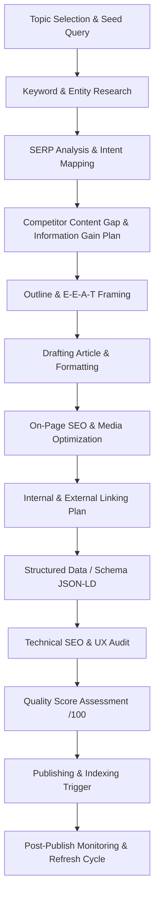

# Professional SEO Master Operating Procedure (SOP) & Content Generation Framework

> **Website Focus**: Government Recruitment, Sarkari Naukri, Hall Tickets, Exam Results, and Education/Career Tools (MahaSandhi)  
> **Core SEO Philosophy**: **Helpful Content > Ranking Manipulation.** Google rewards primary sources, freshness, information gain, and true utility for searcher intent. Never guarantee rankings.

---

## 1. SEO MASTER WORKFLOW



### Complete End-to-End Workflow:
1. **Keyword Research**: Identify primary query, secondary variations, long-tail phrases, and semantic entities.
2. **Search Intent Analysis**: Classify intent (Informational, Commercial, Transactional, Navigational) and define user goals.
3. **SERP Analysis**: Analyze top 10 Google results for snippet types, PAA boxes, intent alignment, and content depth.
4. **Competitor Analysis**: Evaluate competitor weaknesses, outdated data, missing tables/steps, and vague claims.
5. **Primary Keyword Selection**: Lock down the core query targeting the highest intent match.
6. **Secondary Keywords**: Collect 5–15 contextual sub-keywords to weave into H2/H3 sections.
7. **Long-Tail Keywords**: Identify specific long-tail queries (e.g., age limits, salary band, official PDF link queries).
8. **Related Entities/Topics**: Identify N-gram entities (e.g., "Hall Ticket", "Cutoff Marks", "Age Relaxation", "Zilla Parishad").
9. **Semantic Keyword Coverage**: Ensure LSI and natural topic-adjacent vocabulary are present.
10. **Topical Authority**: Connect new content into existing content clusters via contextual internal links.
11. **Content Outline**: Build logical H1 -> H2 -> H3 hierarchy with dedicated sections for intent satisfaction.
12. **Article Writing**: Draft clear, fluff-free, active-voice content in Marathi/English tailored to searchers.
13. **On-Page SEO**: Optimize Title, H1, Meta Description, URL Slug, and natural keyword density.
14. **Internal Linking**: Link to 3–5 relevant hub/article pages; plan incoming links from main category pages.
15. **External Linking**: Cite official notification PDFs, university portals, government gazettes, and authentic sources.
16. **Images & Image SEO**: Compress images (WebP/AVIF), set explicit width/height, write descriptive descriptive ALT text.
17. **Schema Markup**: Implement validated JSON-LD (`JobPosting`, `Article`, `FAQPage`, `BreadcrumbList`).
18. **E-E-A-T Verification**: Verify author credentials, update date, official reference citations, and real data points.
19. **UX & Readability**: Format short paragraphs (1-3 sentences), bullet points, highlight badges, and comparison tables.
20. **CTR Optimization**: Craft 3 high-converting, non-clickbait titles and meta descriptions.
21. **Technical SEO**: Verify canonical tags, OpenGraph metadata, mobile layout responsiveness, and fast LCP.
22. **Indexing**: Submit updated URL via sitemap and Google Search Console URL Inspection.
23. **Post-Publication Monitoring**: Track rankings, CTR, impressions, and positions in GSC at 2-week and 60-day intervals.
24. **Content Updating**: Schedule periodic refreshes whenever dates, vacancies, exam dates, or official notices update.

---

## 2. KEYWORD RESEARCH

For every new article, perform multi-dimensional keyword extraction:

- **Primary Keyword**: Exact query with high search demand and clear intent match.
- **Secondary Keywords**: Close variants and phrase variations.
- **Long-Tail Keywords**: 4+ word specific queries answering precise sub-questions.
- **Question Keywords**: "How to apply...", "What is the eligibility...", "When will result be declared...".
- **Related Searches**: Terms found at the bottom of the SERP.
- **Semantic Terms / Entities**: Key terms like "Selection Process", "Pay Scale", "Official Website Link", "Application Fee".

### Intent Classification
| Intent Type | User Goal | Example Query | Content Requirement |
| :--- | :--- | :--- | :--- |
| **Informational** | Wants to learn or understand | *MPSC Group C Syllabus 2026 PDF* | Full subject breakdown, marks pattern, table |
| **Commercial** | Wants to compare options/eligibility | *MPSC Age Relaxation rules category wise* | Detailed category breakdown table, age calculator link |
| **Transactional** | Ready to act or download | *PDCC Bank Peon Hall Ticket Download link* | Direct download button, step-by-step instructions |
| **Navigational** | Searching for specific portal | *MahaSandhi Current Recruitment* | Clear hub link, fast page loading |

### Natural Placement Rule:
- **Title Tag**: Primary Keyword as close to the beginning as possible.
- **H1 Heading**: Primary Keyword or direct Marathi variant.
- **URL Slug**: Clean, hyphenated primary keyword (e.g., `/mpsc-group-c-bharti-2026`).
- **First 100 Words**: Primary keyword and core intent answer.
- **H2 Headings**: Secondary keywords and entity topics.
- **Body Text**: Natural semantic variations, long-tail phrases, and synonyms.
- **Meta Description**: Primary keyword + CTA.
- **Image ALT Text**: Descriptive context incorporating keywords naturally.

*Strict Rule: Never force exact-match keywords at the expense of grammar, natural phrasing, or readability.*

---

## 3. SERP ANALYSIS

Before writing a single word, run a live SERP audit for the target query:

1. **Dominant Intent**: Is Google displaying news, direct download pages, long guides, or official portals?
2. **Current Top 10 Formats**:
   - Tabular summaries?
   - Step-by-step numbered lists?
   - Direct PDF link roundups?
3. **SERP Features**:
   - Featured Snippet (Paragraph, Table, List)
   - People Also Ask (PAA) boxes
   - Top Stories / News carousel
   - Sitelinks / Image Pack
4. **Common Entities**: Identify recurring terminology across top 5 ranking pages.
5. **Content Gaps & Deficiencies**:
   - Are competitors using generic information?
   - Are exam dates or vacancy counts outdated?
   - Is the application link hidden behind intrusive ads?
   - Is the layout hard to read on mobile?

---

## 4. COMPETITOR CONTENT GAP

Do not simply rewrite top-ranking articles. Create a **Content Gap matrix**:

### CONTENT GAP → OUR SOLUTION MATRIX

| Competitor Weakness | Our Superior Solution |
| :--- | :--- |
| Vague application fee details | Explicit table breakdown by UR / OBC / SC / ST / Divyang |
| Missing step-by-step online application guide | Step-by-step walkthrough with direct portal link |
| Outdated exam dates or dead links | Verified official notification date + active PDF download link |
| Wall of text with no visual structure | Highlight badges, responsive tables, countdown timers |
| No Marathi explanation for key eligibility terms | Clear Marathi summary alongside English technical terms |

---

## 5. SEARCH INTENT

Define the search intent parameters before drafting:

- **Primary Search Intent**: Direct answer to user's main objective.
- **Secondary Intent**: Next logical questions the user will ask after getting the primary answer.
- **User Problem**: Confusion about eligibility, missing direct download link, or unclear date deadlines.
- **Actionable Goal**: Successfully download hall ticket, verify qualification, or complete online form.
- **Satisfying Answer Requirements**: Clear top summary, structured overview table, direct official link, deadline warning.

---

## 6. ARTICLE STRUCTURE

Adhere to a clean, semantic HTML5 structure:

```
H1: [Primary Keyword / Official Title]
├── Intro Paragraphs (Problem + Immediate Answer + Outline)
├── Quick Summary Table (Vacancies, Organization, Last Date, Official Link)
├── H2: Eligibility Criteria (पात्रता व वयोमर्यादा)
│   ├── H3: Educational Qualification
│   └── H3: Age Limit & Relaxation
├── H2: Vacancy Details & Salary Band (जागा व वेतनमान)
├── H2: Selection Process & Exam Pattern (निवड प्रक्रिया)
├── H2: Step-by-Step How to Apply (अर्ज कसा करावा)
├── H2: Important Links & Official Notification PDF (महत्वाच्या लिंक्स)
├── H2: Frequently Asked Questions (FAQ)
└── Conclusion / Next Steps
```

---

## 7. INTRODUCTION

The introduction must follow the **APP Framework (Agree, Promise, Preview)**:

1. **Immediate Recognition (0-15 words)**: State the exact recruitment or exam update clearly.
2. **Relevance & Urgency**: State total vacancies, last date, and who is eligible.
3. **Preview**: State what key details (PDF link, age limit, application steps) are covered below.
4. **Primary Keyword Integration**: Inclusion within the first 2 sentences naturally.

*Avoid filler phrases like: "In today's fast-paced world...", "As we all know...", "Government jobs are very popular...".*

---

## 8. INFORMATION GAIN

To outperform existing SERP results, every article MUST include at least 3 original **Information Gain elements**:

- [x] **Verified Summary Table**: Clean, responsive table summarizing vacancies, age limit, fee, and dates.
- [x] **Direct Official PDF Links**: Tested, working links directly to official department notifications.
- [x] **Bilingual Clarity (Marathi + English)**: Precise Marathi translations for official eligibility conditions.
- [x] **Interactive Tool Cross-Link**: Direct link to MPSC Age Calculator, SGPA/CGPA converter, or Category filter.
- [x] **Date Extension Alerts**: Explicit visual callouts for extended dates, postponements, or hall ticket releases.

---

## 9. E-E-A-T (Experience, Expertise, Authoritativeness, Trustworthiness)

Build maximum trust for Google Quality Raters:

- **Experience**: First-hand testing of official application portals and verification of PDF announcements.
- **Expertise**: Accurate breakdown of government notification terms (e.g., PESA updates, Divyang scribe rules, Waiting list validity).
- **Authoritativeness**: Citing official sources (MPSC, UPSC, SBI, IBPS, Mahajyoti, Mahagenco, Maharashtra Govt Gazettes).
- **Trustworthiness**:
  - Transparent "Last Updated" timestamp.
  - Clear Disclaimer that MahaSandhi provides guidance and official links without impersonating government bodies.
  - Author bio or publishing team credentials.

*Strict Rule: Never fabricate quotes, experience, official statements, or data.*

---

## 10. ON-PAGE SEO CHECKLIST

### 1. Title Tag
- Length: 50–60 characters (or ~580px).
- Contains primary keyword near the front.
- Includes target year (e.g., `२०२६` / `2026`) and site branding (`- MahaSandhi`).

### 2. URL Slug
- Short, clean, lowercase, hyphens only.
- Example: `/pdcc-bank-peon-hall-ticket-2026`.

### 3. Meta Description
- Length: 140–155 characters.
- Includes primary keyword + compelling value proposition + Call to Action.

### 4. Headings
- Exactly one `<h1>` per page.
- Logical hierarchy (`H2` for main topics, `H3` for sub-points).
- Keywords inserted naturally.

### 5. Body Copy & Density
- Natural keyword density (~1–1.5%).
- Semantic entities and variations included naturally.

---

## 11. FEATURED SNIPPET OPTIMIZATION

Structure content to capture position #0:

- **Paragraph Snippet**: Answer "What is [X]" in 40–50 words immediately following an H2/H3 heading.
- **Table Snippet**: Use clean `<table>` HTML markup with clear `<thead>` and `<tbody>` headers (e.g., Fee structure, Qualification comparison).
- **Numbered List Snippet**: Use `<ol>` with ordered steps for "How to Apply" or "How to Download Hall Ticket".
- **Bullet List Snippet**: Use `<ul>` for lists of documents required or eligible districts.

---

## 12. PEOPLE ALSO ASK (PAA) OPTIMIZATION

Identify top PAA queries from Google SERP and format them as H3 or H2 headings under a dedicated **FAQ Section**:

- Format answers in 2–4 concise sentences (30–60 words).
- Provide immediate direct answers before expanding.
- Include structured `FAQPage` JSON-LD schema matching the visible text.

---

## 13. INTERNAL LINKING PLAN

Maintain a hub-and-spoke content architecture:

```
                  [ Recruitment Hub / Category Page ]
                                  │
      ┌───────────────────────────┼───────────────────────────┐
      ▼                           ▼                           ▼
[ MPSC Bharti Post ]    [ Bank Job Post ]            [ District Job Post ]
      │                           │                           │
      └───────────────────────────┴───────────────────────────┘
                                  │ (Cross-links to tools/related jobs)
                                  ▼
                     [ MPSC Age Calculator / Tools ]
```

### Internal Link Rules:
- Every new article MUST link to at least 3 related articles or hubs.
- Every new article MUST be linked from its relevant category page or district index.
- Anchor text must be descriptive (e.g., "MPSC Combine Group C Advertisement Details") rather than generic ("click here").

---

## 14. EXTERNAL LINKING

- Link to authoritative official websites (e.g., `mpsc.gov.in`, `sbi.co.in`, `mahajyoti.org.in`).
- Set `rel="noopener noreferrer"` for all external target `_blank` links.
- Only link to verified, ad-free official PDF sources or government portals.

---

## 15. IMAGE SEO

For every image used in an article:

- **Format**: Modern WebP or AVIF.
- **Filename**: Descriptive, lowercase with hyphens (e.g., `mpsc-group-c-hall-ticket-download-step.webp`).
- **ALT Text**: Concise, descriptive alt text explaining the image content for screen readers and search bots.
- **Dimensions**: Always specify explicit `width` and `height` attributes to prevent Cumulative Layout Shift (CLS).
- **Loading**: Set `loading="lazy"` for all images below the fold.

---

## 16. SCHEMA & STRUCTURED DATA (JSON-LD)

Implement valid, validated JSON-LD scripts:

### 1. JobPosting Schema (For active recruitment posts)
```json
{
  "@context": "https://schema.org/",
  "@type": "JobPosting",
  "title": "MPSC Group C Recruitment 2026",
  "description": "Official recruitment notification for MPSC Group C vacancies...",
  "datePosted": "2026-10-08",
  "validThrough": "2026-11-15",
  "employmentType": "FULL_TIME",
  "hiringOrganization": {
    "@type": "Organization",
    "name": "Maharashtra Public Service Commission",
    "sameAs": "https://mpsc.gov.in"
  },
  "jobLocation": {
    "@type": "Place",
    "address": {
      "@type": "PostalAddress",
      "addressRegion": "Maharashtra",
      "addressCountry": "IN"
    }
  }
}
```

### 2. BreadcrumbList Schema
```json
{
  "@context": "https://schema.org",
  "@type": "BreadcrumbList",
  "itemListElement": [
    {
      "@type": "ListItem",
      "position": 1,
      "name": "Home",
      "item": "https://mahasandhi.in/"
    },
    {
      "@type": "ListItem",
      "position": 2,
      "name": "Category",
      "item": "https://mahasandhi.in/category/mpsc"
    },
    {
      "@type": "ListItem",
      "position": 3,
      "name": "MPSC Group C 2026",
      "item": "https://mahasandhi.in/mpsc-group-c-bharti-2026"
    }
  ]
}
```

---

## 17. TECHNICAL SEO AUDIT

Ensure every published page satisfies core technical standards:

- [x] **Canonical Tag**: Unique `<link rel="canonical" href="https://mahasandhi.in/slug" />` present.
- [x] **Robots Directives**: `index, follow, max-image-preview:large`.
- [x] **Sitemap**: Page dynamically included in `/sitemap.xml`.
- [x] **Mobile Responsiveness**: Verified fluid layout across 320px–428px viewports (no overflow).
- [x] **HTTPS & Security**: SSL encryption enabled.
- [x] **Core Web Vitals**:
  - LCP (Largest Contentful Paint) < 2.5s
  - CLS (Cumulative Layout Shift) < 0.1
  - INP (Interaction to Next Paint) < 200ms
- [x] **Open Graph & Social Meta**: Complete `og:title`, `og:description`, `og:image`, `twitter:card`.

---

## 18. UX & READABILITY

- **Paragraph Length**: 1 to 3 sentences max.
- **Typography**: Modern clean fonts (Inter/Outfit/Roboto), line-height 1.6+.
- **Scannability**: Bold key terms, use callout boxes for dates/warnings, list qualifications in bullet points.
- **Tables**: Styled with horizontal scrolling wrappers for mobile (`overflow-x-auto`).
- **No Filler**: Zero fluffy introductions or repetitive paragraphs.

---

## 19. CTR OPTIMIZATION

For every article, generate 3 Title Tag options and 2 Meta Description options:

### Title Formulas:
1. **SEO / Direct**: `[Topic] २०२६: [Vacancies] जागांसाठी जाहिरात प्रसिद्ध | MahaSandhi`
2. **Action / Urgency**: `[Topic] Hall Ticket 2026 Out: Direct Download Link & Exam Date`
3. **Comprehensive**: `[Topic] Recruitment 2026 - Eligibility, Salary & Apply Online`

---

## 20. CONTENT FRESHNESS & REFRESH CYCLE

- **Recruitment Posts**: Update when dates extend, hall tickets release, answer keys drop, or results are announced.
- **Timestamps**: Display visible `date` and updated status badge.
- **Expired Jobs**: Clearly label closed applications with `Closed` status pills to maintain user trust.

---

## 21. AI CONTENT QUALITY GUARDRAILS

To prevent generic AI quality penalties:

- ❌ **BAN**: "In today's fast-paced digital world...", "In conclusion...", "Delve into...", "Furthermore...", "Testament to...".
- ❌ **BAN**: Unsubstantiated claims, fake statistics, or generic restatements of competitor text.
- ✅ **REQUIRE**: Specific vacancy numbers, exact fee amounts, real eligibility criteria, verified official URLs, and clear Marathi summaries.

---

## 22. FACT-CHECKING SOP

Before publishing:

1. Verify vacancy numbers against official PDF page numbers.
2. Confirm last application date and fee payment deadlines.
3. Check official website URLs to ensure no affiliate or spam redirects.
4. Verify age limits against official category relaxation rules.

---

## 23. ARTICLE QUALITY SCORECARD (/100)

| Evaluation Category | Max Points | Passing Score |
| :--- | :---: | :---: |
| Search Intent Alignment | 10 | 9 |
| Content Depth & Accuracy | 10 | 9 |
| Information Gain & Original Value | 10 | 8 |
| E-E-A-T & Trust Signals | 10 | 9 |
| On-Page SEO (Title, Meta, Headings) | 10 | 9 |
| Internal & External Linking | 10 | 8 |
| Image & Media SEO | 10 | 8 |
| UX, Formatting & Mobile Readability | 10 | 9 |
| Technical SEO & Core Web Vitals | 10 | 9 |
| CTR Potential & Headline Clarity | 10 | 8 |
| **TOTAL SCORE** | **/100** | **≥ 86 (Minimum to Publish)** |

---

## 24. FINAL PUBLISHING CHECKLIST

- [ ] Search intent satisfied in first 100 words.
- [ ] Primary & secondary keywords naturally placed.
- [ ] Competitor content gap addressed.
- [ ] Original information gain included (table, verified steps, or bilingual breakdown).
- [ ] H1 tag unique and contains core keyword.
- [ ] Heading hierarchy (`H1 -> H2 -> H3`) strictly maintained.
- [ ] URL slug clean, lowercase, and short.
- [ ] Meta description written with CTA (140-155 characters).
- [ ] Minimum 3 contextual internal links added.
- [ ] Official PDF notification linked.
- [ ] Images formatted as WebP with explicit width/height and descriptive ALT text.
- [ ] Schema JSON-LD validated without errors.
- [ ] Canonical URL verified.
- [ ] Mobile responsive layout tested (no horizontal scroll).
- [ ] Fact-checked against official PDF announcement.
- [ ] Quality score calculated ≥ 86/100.

---

## 25. POST-PUBLISH SEO MONITORING

- **Day 1–3**: Check indexing status via Google Search Console URL Inspection.
- **Week 2**: Audit initial impressions, search queries, and average positions in GSC.
- **Month 1**: Check CTR for queries ranking in positions 4–10; optimize title/meta description if CTR < 3%.
- **Month 3**: Perform internal link audit to pass link equity from newer posts.

---

## 26. CORE GOOGLE SEO PRINCIPLE

> **Helpfulness > Search Engine Manipulation**
> 
> Content must be created primarily to help human searchers accomplish their goals. We do not use deceptive tactics, keyword stuffing, hidden text, or guarantee Google rankings. The highest ranking pages are those that provide the most accurate, fast, clear, and trustworthy answer to the user's intent.

---

## 27. OUTPUT FRAMEWORK FOR NEW ARTICLES

Whenever a new topic is provided, generate the complete response following this exact structure:

```markdown
# SEO Content Package: [Topic Name]

### A. SEO Brief
- **Primary Keyword**:
- **Search Intent**:
- **Target Audience**:
- **Content Angle**:
- **Information Gain Opportunity**:

### B. Keyword Map
- **Primary**:
- **Secondary**:
- **Long-tail**:
- **Questions**:
- **Entities**:

### C. SERP Analysis
- **Dominant Intent**:
- **Top Competitor Weaknesses**:
- **Required SERP Features**:

### D. Competitor Content Gap
| Competitor Gap | Our Solution |

### E. SEO Article Outline
[Full H1 -> H2 -> H3 Structure]

### F. Title Options (3 variants)
1.
2.
3.

### G. Meta Description Options (2 variants)
1.
2.

### H. URL Slug
`/slug-name`

### I. Internal Linking Plan
| Source Page | Target Page | Anchor Text | Reason |

### J. External Source Plan
| Resource | URL | Reason |

### K. Image Plan
| Image Description | Filename | Alt Text |

### L. Schema Plan
[Valid JSON-LD Snippet]

### M. E-E-A-T Plan
- Author & Expertise:
- Official Source Citations:

### N. Full Article Draft (Astro / Markdown Component)

### O. Final SEO Score (/100)

### P. Pre-Publish Checklist
```

---

## 28. BILINGUAL LANGUAGE POLICY & RULES (MARATHI & ENGLISH)

For every new blog post/article generated for MahaSandhi:

1. **Default Rule (Bilingual Multi-Language)**:
   - **ALWAYS** write the complete, full-depth content in **BOTH Marathi and English**.
   - **Marathi Version**: Placed in the main default body of `<ArticleContainer>`.
   - **English Version**: Placed inside `<div slot="english">...</div>`.
   - **Identical Structure & Data**: Both language versions MUST feature identical tables, key metrics, salary breakdowns, eligibility cards, official action buttons, and FAQ items.

2. **Exception Rule (Marathi Only)**:
   - **ONLY** write the article solely in Marathi if the user explicitly specifies **"only in Marathi"** or **"fakta marathi"** in their prompt. Otherwise, ALWAYS provide both languages.

3. **Data Synchronization**:
   - Ensure all numerical figures (vacancies, age limits, fee amounts, deadlines) and links in Marathi and English match 100%.

